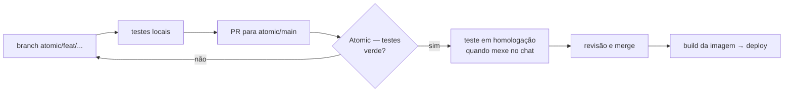

# Como mudar o Atomic Chat

**Regra:** nada vai direto para a `atomic/main`. Toda mudança nasce numa branch própria,
é testada e só então entra na main por Pull Request. A branch `atomic/main` é protegida
no GitHub e aceita mudanças só por PR.

## Fluxo



1. **Branch** a partir da `atomic/main` atualizada:
   - `atomic/feat/<nome>`: funcionalidade nova
   - `atomic/fix/<nome>`: correção
   - `atomic/upgrade-<versão>`: atualização do Rocket.Chat (ver `docs/FORK.md`)
2. **Teste local** do que você mexeu (comandos abaixo).
3. **Pull Request** para `atomic/main`, explicando o que muda e como testar.
4. **Workflow "Atomic — testes"** roda sozinho no PR: testes do conector Hermes, ShellCheck dos
   scripts, validação do `docker-compose` e dos YAMLs. PR com teste vermelho não entra.
5. **Homologação**: mudança que afeta o chat em si (imagem nova, branding, config do Hermes)
   é testada num ambiente de teste antes do merge. Ver "Homologação" abaixo.
6. **Merge** e, se mudou o Rocket.Chat, rodar o build da imagem.

## Testes locais

Conector Hermes (precisa de um checkout do hermes-agent no commit fixado em
`.github/workflows/atomic-checks.yml`):

```bash
cd atomic/hermes && PYTHONPATH=$PWD/plugins:/caminho/hermes-agent python -m pytest tests -q -p no:asyncio -c /dev/null --rootdir .
```

Scripts e compose:

```bash
shellcheck atomic/deploy/scripts/*.sh atomic/branding/*.sh
```

```bash
cd atomic/deploy && cp .env.example .env && cp .env.hermes.example .env.hermes && docker compose config -q
```

## Homologação

Enquanto não houver uma VPS separada, a homologação roda na própria VPS com outro nome de projeto
e outro subdomínio (`chat-hml.atomicgroup.com.br`), sem tocar nos dados de produção:

```bash
cd atomic/deploy && cp .env .env.hml
```

Edite `.env.hml` (`CHAT_DOMAIN=chat-hml.atomicgroup.com.br` e `RC_TAG` da imagem em teste). Depois:

```bash
docker compose -p atomic-chat-hml --env-file .env.hml up -d mongodb rocketchat
```

> A homologação compartilha o Caddy de produção: adicione o bloco do subdomínio no `Caddyfile`
> quando formos ativá-la. Esse ajuste fica para o PR do primeiro deploy.
