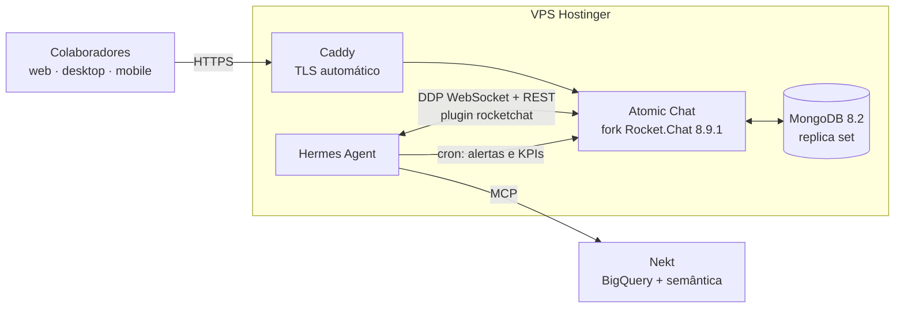

# Atomic Chat

Comunicação interna da Atomic Group: **fork do Rocket.Chat 8.9.1** + **Hermes Agent** (IA) + **Nekt** (dados),
hospedado em uma VPS da Hostinger.

Tudo que é da Atomic fica nesta pasta `atomic/` (e em `.github/workflows/atomic-build.yml`).
O restante do repositório é o código do Rocket.Chat. Mantenha essa separação: é ela que permite
atualizar o fork sem dor (ver [docs/FORK.md](docs/FORK.md)).

## Arquitetura



| Fluxo | Como funciona |
|---|---|
| Perguntar ao bot | DM para `@hermes` ou `@hermes ...` em um canal. A resposta vem na thread. |
| Consultas de dados | O Hermes chama as ferramentas MCP da Nekt (`ask_nekt`, `execute_sql`, …) e responde com números e a fonte. |
| Alertas automáticos | Jobs de cron do Hermes (`deliver=rocketchat`) consultam a Nekt e postam na sala definida em `ROCKETCHAT_HOME_CHANNEL`. |
| Bots com dados | Cada bot/skill do Hermes pode usar a Nekt como base para agir (ex.: resumo diário de pipeline). |

## Estrutura

```
atomic/
├── README.md                    este arquivo
├── docs/
│   ├── FORK.md                  regras do fork e como atualizar o Rocket.Chat
│   ├── HOSTINGER.md             passo a passo da VPS
│   ├── LOCAL.md                 rodar o chat no seu computador (Docker Desktop)
│   └── ROADMAP.md               fases do projeto
├── branding/                    logo, cores, CSS e textos da Atomic
├── deploy/
│   ├── docker-compose.yml       Caddy + Rocket.Chat + MongoDB + Hermes
│   ├── docker-compose.local.yml ajustes para rodar local (localhost:3000, sem HTTPS)
│   ├── Caddyfile
│   ├── .env.example             variáveis do servidor
│   ├── .env.hermes.example      segredos do Hermes (API do modelo, token do bot, Nekt)
│   └── scripts/                 bootstrap da VPS e backup
└── hermes/
    ├── config.yaml              modelo do config do Hermes (modelo, plugin, MCP da Nekt)
    ├── SOUL.md                  personalidade do bot
    ├── plugins/rocketchat/      conector Hermes ↔ Rocket.Chat (Python)
    └── tests/                   testes do conector com Rocket.Chat simulado
```

## Rodar localmente

Com Docker Desktop: veja [docs/LOCAL.md](docs/LOCAL.md). Em resumo, dentro de `atomic/deploy`:

```bash
docker compose -f docker-compose.yml -f docker-compose.local.yml up -d
```

O chat abre em http://localhost:3000.

## Como contribuir

Toda mudança vai em branch própria, testada, e entra na `atomic/main` só por PR: veja [CONTRIBUTING.md](CONTRIBUTING.md).

## Rodar os testes do conector

```bash
git clone --depth 1 https://github.com/NousResearch/hermes-agent /tmp/hermes-agent
```

```bash
cd /tmp/hermes-agent && python -m venv .venv && . .venv/bin/activate && pip install -e . ruamel.yaml aiohttp pytest
```

```bash
cd <este-repo>/atomic/hermes && PYTHONPATH=$PWD/plugins:/tmp/hermes-agent python -m pytest tests -q -p no:asyncio -c /dev/null --rootdir .
```

## Licença

O Rocket.Chat é MIT, **exceto** `apps/meteor/ee/` e `ee/`, que têm licença Enterprise própria.
O fork pode usar e modificar livremente o código MIT. Não ative nem modifique recursos Enterprise
sem licença; veja [docs/FORK.md](docs/FORK.md).
